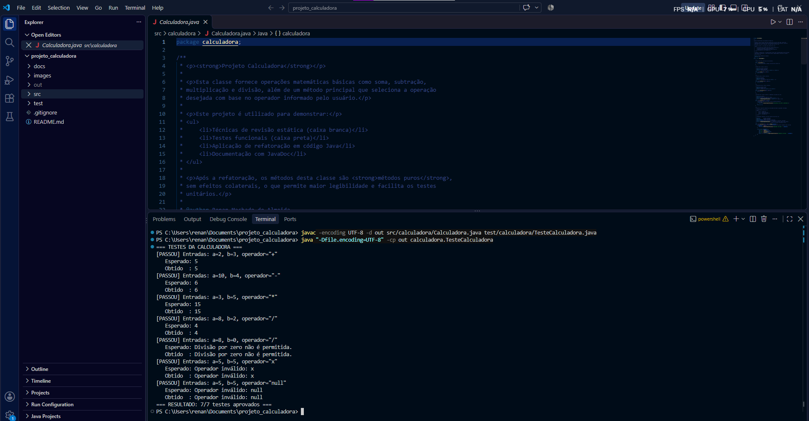
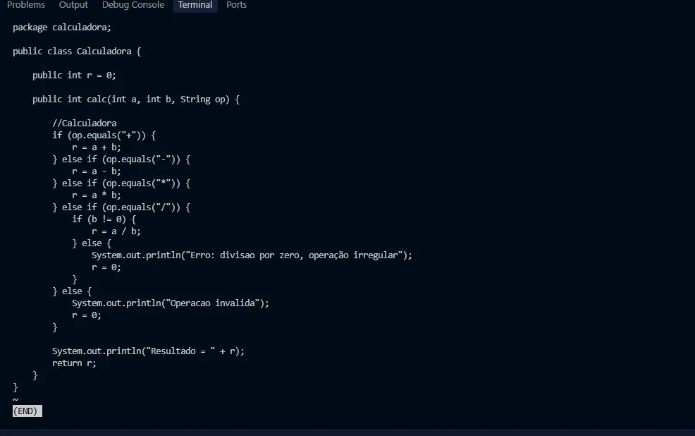
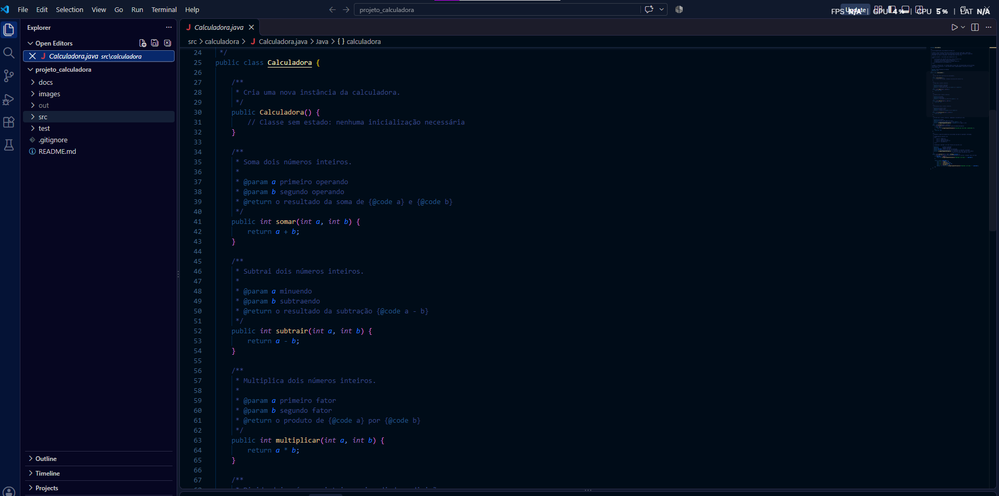
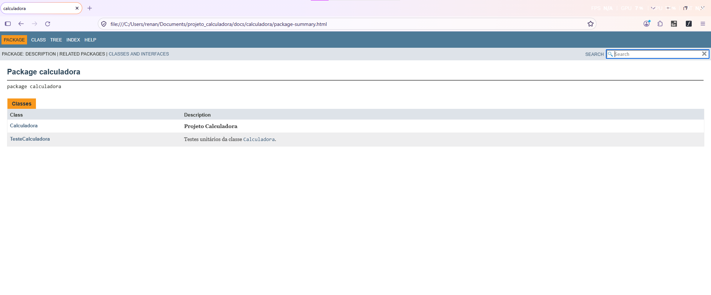
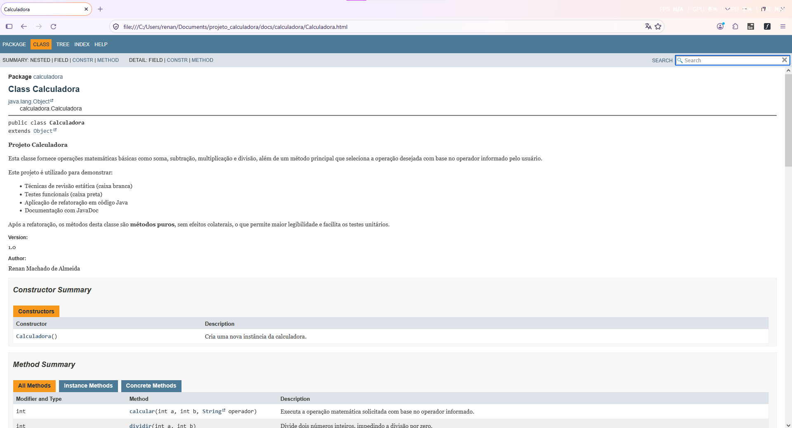

# Projeto Calculadora — FinançApp

> Projeto acadêmico desenvolvido com foco em Qualidade de Software, Testes, Refatoração, Documentação e Versionamento.

> 📌 **Esta é a branch `Refatoracao`:** código refatorado, testes reexecutados, JavaDoc e `docs/`. A versão inicial está na branch [`main`](https://github.com/draikameta/projeto_calculadora).

---

## 1. Identificação do Projeto

**Projeto:** Projeto Calculadora  
**Contexto:** FinançApp  
**Aluno:** Renan Machado de Almeida  
**RA:** 250934  
**Curso:** Análise e Desenvolvimento de Sistemas  
**Disciplina:** UX/UI e Testes de Software (AS406TSN1)  
**Professor:** Daniel Ohata  
**Semestre:** 2026.2  

---

# 2. Visão Geral

O projeto consiste no desenvolvimento de um módulo de cálculos matemáticos básicos em Java para a startup fictícia **FinançApp**.

O módulo foi desenvolvido com o objetivo de ser utilizado futuramente em funcionalidades de controle financeiro, como:

- orçamento mensal;
- divisão de despesas;
- projeções financeiras;
- cálculos auxiliares.

Além do funcionamento correto das operações, o projeto aplica práticas de qualidade de software relacionadas a:

- testes;
- tratamento de erros;
- refatoração;
- documentação;
- versionamento;
- manutenção de código.

---

# 3. Problema

Durante o desenvolvimento da aplicação FinançApp, foi identificada a necessidade de criar um módulo matemático reutilizável.

Entretanto, a equipe definiu que o módulo não deveria apenas funcionar corretamente, mas também apresentar:

- código legível;
- testes automatizados;
- tratamento de falhas;
- documentação técnica;
- controle de versões;
- facilidade de manutenção.

O desafio consiste, portanto, em desenvolver uma solução funcional e ao mesmo tempo aplicar boas práticas de Engenharia de Software.

---

# 4. Objetivo

## 4.1 Objetivo Geral

Desenvolver uma calculadora em Java aplicando práticas de qualidade, testes, documentação, refatoração e versionamento.

## 4.2 Objetivos Técnicos

- implementar operações matemáticas básicas;
- tratar entradas inválidas;
- impedir divisão por zero;
- desenvolver testes automatizados;
- refatorar o código sem alterar seu comportamento esperado;
- documentar classes e métodos com JavaDoc;
- gerar documentação HTML;
- utilizar Git e GitHub;
- organizar commits e branches;
- manter documentação técnica no README.

---

# 5. Escopo Funcional

| ID | Funcionalidade | Descrição | Status |
|---|---|---|---|
| RF01 | Soma | Soma dois números inteiros | ✅ |
| RF02 | Subtração | Subtrai dois números inteiros | ✅ |
| RF03 | Multiplicação | Multiplica dois números inteiros | ✅ |
| RF04 | Divisão | Divide dois números inteiros | ✅ |
| RF05 | Validação de divisão | Impede divisão por zero | ✅ |
| RF06 | Operação inválida | Trata operadores não suportados | ✅ |

---

# 6. Requisitos Não Funcionais

| ID | Categoria | Requisito | Status |
|---|---|---|---|
| RNF01 | Qualidade | O código deve possuir organização e legibilidade | ✅ |
| RNF02 | Testabilidade | As operações devem possuir testes automatizados | ✅ |
| RNF03 | Manutenção | O código deve permitir refatoração sem alteração funcional | ✅ |
| RNF04 | Documentação | Classes e métodos devem possuir JavaDoc | ✅ |
| RNF05 | Versionamento | O projeto deve utilizar Git e GitHub | ✅ |
| RNF06 | Confiabilidade | Erros não devem interromper inesperadamente a execução | ✅ |

---

# 7. Tecnologias Utilizadas

| Tecnologia | Versão | Utilização |
|---|---|---|
| Java / JDK | 21 | Desenvolvimento e compilação |
| Testes | — | Classe `TesteCalculadora` (executada por `main`, com `try/catch`) |
| Git | 2.43 | Controle de versão |
| GitHub | — | Repositório remoto |
| JavaDoc | — | Documentação |
| IDE | Visual Studio Code | Ambiente de desenvolvimento |

---

# 8. Estrutura do Projeto

```text
projeto_calculadora/
│
├── src/
│   └── calculadora/
│       └── Calculadora.java
│
├── test/
│   └── calculadora/
│       └── TesteCalculadora.java
│
├── docs/
│   └── index.html
│
├── images/
│   ├── testes/
│   ├── javadoc/
│   └── refatoracao/
│
├── README.md
├── .gitignore
└── demais arquivos do projeto
```

---

# 9. Explicação das Operações

Método principal: `public int calcular(int a, int b, String operador)`, que seleciona a operação com um `switch` e delega para métodos puros.

| Operação | Símbolo | Método | Exemplo | Resultado |
|---|:---:|---|---|---|
| Soma | `+` | `somar(a, b)` | `calcular(2, 3, "+")` | `5` |
| Subtração | `-` | `subtrair(a, b)` | `calcular(10, 4, "-")` | `6` |
| Multiplicação | `*` | `multiplicar(a, b)` | `calcular(3, 5, "*")` | `15` |
| Divisão | `/` | `dividir(a, b)` | `calcular(8, 2, "/")` | `4` |

**Tratamento de erros:** situações inválidas lançam `IllegalArgumentException` com mensagem clara, que pode ser tratada com `try/catch` sem derrubar a aplicação.

| Situação | Exemplo | Mensagem |
|---|---|---|
| Divisão por zero | `calcular(8, 0, "/")` | `Divisão por zero não é permitida.` |
| Operador inválido | `calcular(5, 5, "x")` | `Operador inválido: x` |
| Operador nulo | `calcular(5, 5, null)` | `Operador inválido: null` |

---

# 10. Como Compilar e Executar

```bash
# compilar
mkdir out
javac -encoding UTF-8 -d out src/calculadora/Calculadora.java test/calculadora/TesteCalculadora.java

# executar os testes
java "-Dfile.encoding=UTF-8" -cp out calculadora.TesteCalculadora

# gerar o JavaDoc
javadoc -encoding UTF-8 -docencoding UTF-8 -charset UTF-8 -private -author -version -d docs src/calculadora/Calculadora.java test/calculadora/TesteCalculadora.java
```

---

# 11. Testes

Os testes ficam em `test/calculadora/TesteCalculadora.java` e exibem **entradas utilizadas**, **resultado esperado** e **resultado obtido**.

| # | Teste | Entradas | Esperado |
|---|---|---|---|
| 1 | Soma | `2, 3, "+"` | `5` |
| 2 | Subtração | `10, 4, "-"` | `6` |
| 3 | Multiplicação | `3, 5, "*"` | `15` |
| 4 | Divisão | `8, 2, "/"` | `4` |
| 5 | Divisão por zero | `8, 0, "/"` | exceção: `Divisão por zero não é permitida.` |
| 6 | Operação inválida | `5, 5, "x"` | exceção: `Operador inválido: x` |
| 7 | Operador nulo | `5, 5, null` | exceção: `Operador inválido: null` |

Resultado após a refatoração: **7/7 testes aprovados**.

### 📸 Print da execução dos testes (após a refatoração)



---

# 12. Refatoração

Realizada nesta branch (`Refatoracao`), aplicando:

- **extração de métodos:** `somar`, `subtrair`, `multiplicar` e `dividir`;
- **simplificação de condicionais:** cadeia de `if/else if` substituída por `switch`;
- **melhoria de nomes:** `calc` → `calcular`, `op` → `operador`;
- **tratamento de erros por exceção:** `IllegalArgumentException` com mensagens claras, no lugar de `println` e resultado `0`;
- **métodos puros:** sem atributo `r` e sem efeitos colaterais (nenhum `println` dentro da calculadora);
- testes executados novamente após a refatoração, todos aprovados.

### 📸 Prints da refatoração

**Antes** (branch `main`):



**Depois** (branch `Refatoracao`):



---

# 13. Documentação JavaDoc

Comentários técnicos e JavaDoc (`@author`, `@version`, `@param`, `@return`, `@throws`) em classes e métodos. A documentação HTML foi gerada na pasta `docs/`; abra `docs/index.html` no navegador.

### 📸 Prints da documentação JavaDoc





---

# 14. Versionamento

| Branch | Conteúdo |
|---|---|
| `main` | Versão inicial: `Calculadora` e `TesteCalculadora` |
| `Refatoracao` | Código refatorado, testes reexecutados, JavaDoc e `docs/` |

Os commits seguem o padrão `feat`, `test`, `refactor`, `docs` e `chore`.

---

# 15. Link do Repositório

https://github.com/draikameta/projeto_calculadora
