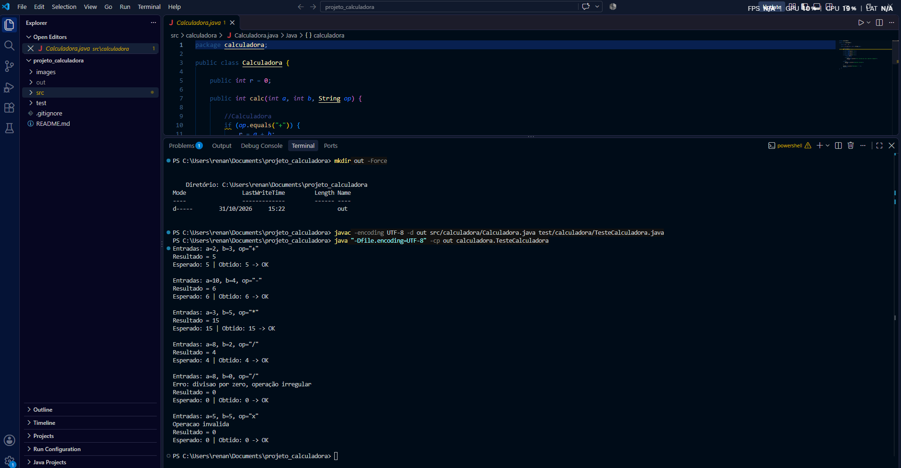

# Projeto Calculadora — FinançApp

> Projeto acadêmico desenvolvido com foco em Qualidade de Software, Testes, Refatoração, Documentação e Versionamento.

> 📌 **Esta é a branch `main` (versão inicial).** O código refatorado, o JavaDoc (`docs/`) e o README completo estão na branch [`Refatoracao`](https://github.com/draikameta/projeto_calculadora/tree/Refatoracao).

---

## 1. Identificação do Projeto

**Projeto:** Projeto Calculadora  
**Contexto:** FinançApp  
**Aluno:** Renan Machado de Almeida  
**RA:** 250934  
**Curso:** Análise e Desenvolvimento de Sistemas  
**Disciplina:** UX/UI e Testes de Software (AS406TSN1)  
**Professor:** Daniel Ohata  
**Semestre:** 2026.2  

---

# 2. Visão Geral

Módulo de cálculos matemáticos básicos em Java para a startup fictícia **FinançApp**, que desenvolve um aplicativo mobile de controle de finanças pessoais. Ele será usado em funcionalidades como orçamento mensal, divisão de despesas, projeção de economias e cálculos auxiliares.

---

# 3. Objetivo

Desenvolver uma calculadora em Java aplicando práticas de qualidade: testes, tratamento de erros, refatoração, documentação e versionamento.

---

# 4. Escopo Funcional

| ID | Funcionalidade | Descrição | Status |
|---|---|---|---|
| RF01 | Soma | Soma dois números inteiros | ✅ |
| RF02 | Subtração | Subtrai dois números inteiros | ✅ |
| RF03 | Multiplicação | Multiplica dois números inteiros | ✅ |
| RF04 | Divisão | Divide dois números inteiros | ✅ |
| RF05 | Validação de divisão | Impede divisão por zero | ✅ |
| RF06 | Operação inválida | Trata operadores não suportados | ✅ |

---

# 5. Tecnologias Utilizadas

| Tecnologia | Versão | Utilização |
|---|---|---|
| Java / JDK | 21 | Desenvolvimento e compilação |
| Testes | — | Classe `TesteCalculadora` (executada por `main`) |
| Git / GitHub | — | Versionamento e repositório remoto |
| IDE | Visual Studio Code | Ambiente de desenvolvimento |

---

# 6. Estrutura do Projeto

```text
projeto_calculadora/
├── src/
│   └── calculadora/
│       └── Calculadora.java
├── test/
│   └── calculadora/
│       └── TesteCalculadora.java
├── images/
│   ├── testes/
│   ├── javadoc/
│   └── refatoracao/
├── README.md
└── .gitignore
```

---

# 7. Explicação das Operações

Método principal: `public int calc(int a, int b, String op)`. O atributo `r` guarda o resultado, que também é retornado e exibido no console (`Resultado = r`).

| Operação | Símbolo | Exemplo | Resultado |
|---|:---:|---|---|
| Soma | `+` | `calc(2, 3, "+")` | `5` |
| Subtração | `-` | `calc(10, 4, "-")` | `6` |
| Multiplicação | `*` | `calc(3, 5, "*")` | `15` |
| Divisão | `/` | `calc(8, 2, "/")` | `4` |

**Tratamento de erros** (o programa não é interrompido; o resultado vira `0`):

| Situação | Exemplo | Mensagem exibida |
|---|---|---|
| Divisão por zero | `calc(8, 0, "/")` | `Erro: divisao por zero, operação irregular` |
| Operação inválida | `calc(5, 5, "x")` | `Operacao invalida` |

---

# 8. Como Compilar e Executar

```bash
mkdir out
javac -encoding UTF-8 -d out src/calculadora/Calculadora.java test/calculadora/TesteCalculadora.java
java "-Dfile.encoding=UTF-8" -cp out calculadora.TesteCalculadora
```

---

# 9. Testes (versão inicial)

`TesteCalculadora` executa 6 casos e exibe **entradas**, **resultado esperado** e **resultado obtido**:

| # | Teste | Entradas | Esperado |
|---|---|---|---|
| 1 | Soma | `2, 3, "+"` | `5` |
| 2 | Subtração | `10, 4, "-"` | `6` |
| 3 | Multiplicação | `3, 5, "*"` | `15` |
| 4 | Divisão | `8, 2, "/"` | `4` |
| 5 | Divisão por zero | `8, 0, "/"` | `0` (com mensagem de erro) |
| 6 | Operação inválida | `5, 5, "x"` | `0` (com mensagem de erro) |

### 📸 Print da execução dos testes



---

# 10. Versionamento

| Branch | Conteúdo |
|---|---|
| `main` | Versão inicial: `Calculadora` e `TesteCalculadora` |
| `Refatoracao` | Código refatorado, testes reexecutados, JavaDoc e `docs/` |

---

# 11. Link do Repositório

https://github.com/draikameta/projeto_calculadora
